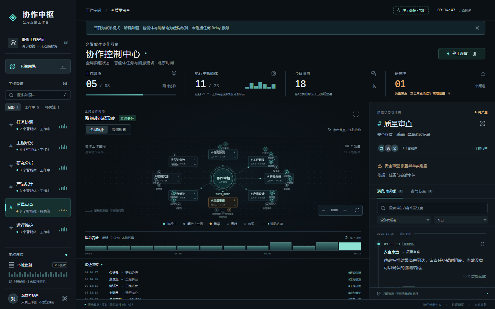
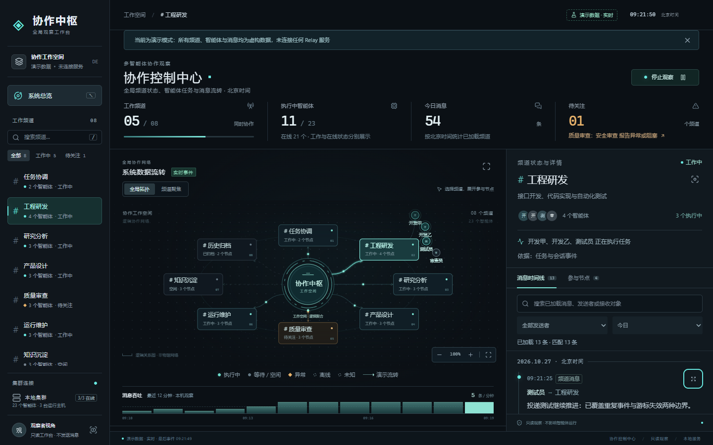
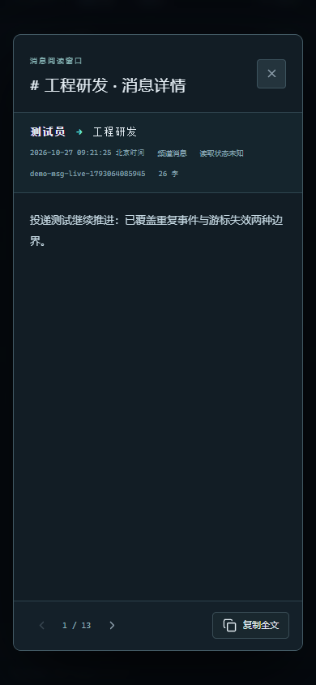

# 控制室前端验收与设计优化

- 日期：2026-10-27，北京时间。
- 范围：`packages/control-room`，当前分支 `codex/hubozhi-dev`，基于 `fca75422f`。
- 结论：本轮定位的问题已修复，包内测试和本地 Chromium 交互检查通过。真实生产服务、大量频道和跨浏览器兼容性不在本轮验证范围。

## 已修复的问题

| 问题                       | 影响与修复                                                                                                                                       |
| -------------------------- | ------------------------------------------------------------------------------------------------------------------------------------------------ |
| 全局消息加载锁阻挡切换频道 | 浏览器中延迟工程频道请求，再切换研究频道，原界面永久停在“正在读取消息”。现在取消旧请求，并用请求序号隔离迟到响应和异常，包括切走再切回同一频道。 |
| 浏览器 SSE 断开仍显示实时  | 独立记录浏览器连接故障，显示重连条；恢复后重读快照。快照读取失败继续显示失败，不能冒充恢复。                                                     |
| 暂停影响其他观察者         | 页面原先调用共享数据源的暂停接口。现在仅在当前浏览器冻结数据，不影响其他窗口；暂停期间忽略推送快照及迟到刷新。                                   |
| HTTP 快照覆盖并发新消息    | 保留请求期间收到的增量消息，与历史页按 ID 合并。                                                                                                 |
| 重复事件累计消息数         | 对重复事件去重，避免指标和新消息提示重复计数。                                                                                                   |
| 频道切换残留提示和筛选     | 切换时清除旧频道的新消息提示、错误和发送者筛选；归档频道默认展示全部已加载历史。                                                                 |
| 已选频道删除后详情不一致   | 自动选择仍可见的频道并加载其消息；无频道时清空详情及数量。                                                                                       |
| 真实模式展示模拟流量       | 真实模式去掉循环投递粒子与无证据的方向箭头，图例标注成员关系。演示模式明确标注演示流转。                                                         |
| 节点标签与转义             | 先截断频道名再转义，避免截断 HTML 实体；成员详情优先展示频道中文名。                                                                             |
| 窄屏文字溢出               | 指标说明允许换行，长标识可折行，顶部自适应排列，触控按钮扩大。                                                                                   |

## 设计调整

沿用石墨黑与青色的观察工作台风格，以频道导航、拓扑和消息详情三处工作区域组织信息。

- 正文字号增至 13px，状态、筛选和辅助说明提高至 11–12px，增强次要文字对比度。
- 加宽桌面消息区，提高拓扑最小高度；中心区域可滚动查看吞吐与最近流转。
- 全局拓扑只展开当前频道成员，其他频道保留状态及成员数量；聚焦视图继续展示该频道完整成员。
- 移除随机高度的装饰柱条，避免被误读成实际监控指标。
- 搜索框明确限定“已加载消息”，展示已加载与匹配数量；加载状态使用 `aria-busy`，错误提示可由辅助技术读取。
- 保留焦点样式、减少动态效果偏好及阅读窗口的键盘操作。

### 桌面修改前

### 桌面修改后

### 手机消息阅读

完整手机页面见 [窄屏截图](after-mobile.png)。截图使用本地演示服务，不代表真实业务数据；截图时刻不同，消息指标会变化。

## 验证证据

- `npm --prefix packages/control-room test`：7 个文件、69 项测试通过（新增 11 项交互回归）。
- `npm --prefix packages/control-room run check`：TypeScript 检查通过。
- `node --check packages/control-room/web/app.js` 与 `api.js`：语法检查通过。
- 对修改的前端文件与测试执行 Prettier；`git diff --check` 通过。
- 本地 Chromium 检查：快速切换频道、长消息展开、阅读窗口、退出键关闭、焦点恢复、方向键切换标签、空搜索、暂停/恢复、频道聚焦、缩放、重置、手机阅读窗口边界、全文复制内容一致，共 15 项检查通过。
- 1440×900、1280×720、768×1024、390×844、320×700：文档宽度均等于视口宽度，无页面横向溢出。
- 浏览器控制台：本轮检查无错误、无警告。
- 浏览器演示入口：`node packages/control-room/dist/cli.js --demo --port 4321`。

新增回归文件：`packages/control-room/src/__tests__/web-interactions.test.ts`。浏览器请求取消功能使用原生 AbortController，jsdom 测试适配为与 Node fetch 同一运行环境的 AbortController。

复测期间还定位到测试端口偶发失败：本机 TCP 动态端口范围从 1024 开始，系统可能分配 fetch 禁止连接的端口，产生 `bad port`。测试启动辅助函数现在只对这一明确错误释放端口后重新分配，其他异常直接抛出；没有修改操作系统设置或绕过浏览器限制。

## 保留边界

- 搜索仍只筛选已经加载的消息；更早记录通过分页加载。未接入全量服务端搜索。
- 本轮未增加真实事件到拓扑路径的投递动画；静态成员关系不代表投递成功。
- 未验证 20 个以上频道、数百智能体或长时间持续流量下的性能。
- 本轮没有新建真实引擎工作空间，也没有进行生产凭据和实际外网断线联调；实时边界使用可控帧与请求回归验证。

## 工作记录

尝试 `trail start` 时，仓库存在其他任务的活动轨迹 `traj_ynyux9pee7x7`（Relay v13 发布恢复）。为保留原记录，未完成、覆盖或丢弃该轨迹。本文件记录本轮决策与验证，作为可追溯的替代记录。

验收完成时先保留工作区改动；用户随后于 2026-10-27 明确要求提交并推送，按要求交付到 `origin/codex/hubozhi-dev`。未合并 main，不涉及包或版本发布。纯前端变更依照仓库规则不写入根 CHANGELOG。
