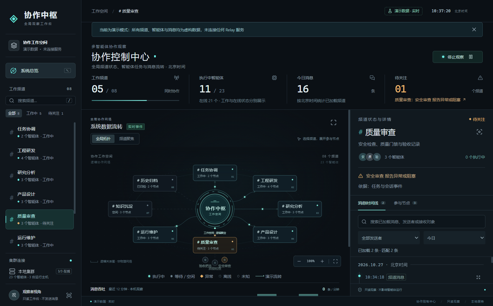
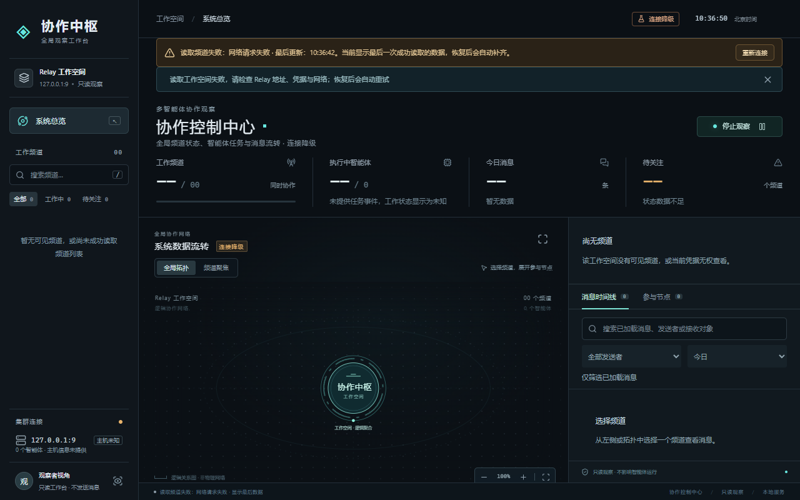

# 桌面托盘版验收（2026-10-27）

- 范围：`packages/control-room` 文案中文化第二轮 + 新增 `packages/control-room-desktop`（Electron 托盘外壳）。
- 分支：`codex/hubozhi-dev`。
- 结论：界面已无英文（仅保留产品名 `Relay`），托盘菜单与状态全中文；Windows 便携版与安装包已产出并在本机跑通。

## 一、界面中文化

逐屏审计（首屏、节点面板、帮助弹窗、阅读弹窗、频道聚焦、断网降级态）后清掉的内容：

| 位置             | 原状                                    | 现在                                                  |
| ---------------- | --------------------------------------- | ----------------------------------------------------- |
| 侧栏工作空间徽标 | 工作空间 id 前两位（演示数据下为 `DE`） | 徽标整体移除，模式由「演示数据 · 未连接服务」直接说明 |
| 证据标签         | `旧版状态事件（status.*）`              | `旧版状态事件`                                        |
| 请求失败提示     | `请求失败（HTTP 404）`                  | `请求失败（状态码 404）`                              |
| 阅读窗口元信息   | 消息 id、`线程 <id>`、`父消息 <id>`     | 只保留字数、`属于消息线程`、`回复了更早的消息`        |
| 连接失败详情     | SDK 原文，如 `fetch failed`             | `网络请求失败`，原始错误只进日志                      |
| 终端日志         | `读取频道失败：Network request failed…` | `读取频道失败：网络请求失败`                          |

`localizeDiagnostic`（`packages/control-room/src/format.ts`）负责把传输层错误命名成中文：
拒绝连接、无法解析地址、连接超时、连接被中断、网络请求失败、安全连接失败、凭据无效、权限不足、
请求过于频繁；4xx/5xx 只在没有更具体原因时兜底使用。剩余拉丁字符一律剔除，兜底给中文短语。

### 桌面窗口（演示数据）



### 断网降级态



页脚为「读取频道失败：网络请求失败 · 显示最后数据」，正文计数显示 `--`，不冒充 0。

## 二、桌面外壳

- 启动后仍是同一个 Web 界面（`packages/control-room/web`），服务端是控制中心打包产物。
- 关窗隐藏到托盘并首次气泡提示；「退出」是唯一结束进程的入口。
- 单实例；端口被占用时从 4320 向后顺延最多 12 个端口；导航限定本地地址，外链交给系统浏览器。
- 无凭据即演示模式，界面顶部说明是演示数据，不会静默连到任何服务。

托盘菜单实测（打包产物运行 `--smoke` 输出）：

```
打开控制中心 | 复制访问地址 | 在浏览器中打开 | —— | 运行模式：演示数据 | 监听地址：127.0.0.1:4320 |
数据连接：演示数据 · 实时 | 工作空间：8 个频道 · 23 个智能体 | 今日消息：16 条 |
更新时间：10:37:21 | —— | 刷新状态 | 开机自动启动 | —— | 退出
```

真实模式但上游不可达时：

```
运行模式：只读观察 · 127.0.0.1:9 | 数据连接：读取工作空间超时 | 工作空间：频道未知 · 智能体未知 |
今日消息：未知
```

连接降级时计数显示「未知」而不是 `0`，与界面「未知不当空闲」的规则一致。

## 三、打包

```bash
npm run package:win -w @agent-relay/control-room-desktop
```

| 产物                                 | 大小  | 说明                                 |
| ------------------------------------ | ----- | ------------------------------------ |
| `RelayControlRoom-14.0.0-便携版.exe` | 71 MB | 免安装，双击即用                     |
| `RelayControlRoom-14.0.0-安装包.exe` | 71 MB | 可选安装目录、开始菜单、桌面快捷方式 |

服务端依赖（含 SDK）由 esbuild 内联到 `dist/server.mjs`（873 KB），安装包不含 `node_modules`。
图标由 `scripts/make-icons.mjs` 用几何绘图生成（`icon.png` 512、`tray.png` 32、`icon.ico` 7 种尺寸），无图像依赖。

## 四、验证证据

- `npx vitest run packages/control-room/ packages/control-room-desktop/`：8 个文件、90 项测试通过。
  新增：`localizeDiagnostic` 3 项、整页拉丁字母扫描 1 项（含帮助与阅读弹窗）、桌面配置/托盘/摘要 18 项。
- `npx tsc -p packages/control-room/tsconfig.json --noEmit`：通过。
- 未打包运行 `electron .`：界面加载、托盘菜单与提示符合预期；`ReleaseControlRoom` 打包产物同样通过。
- 断网降级态：页面可见文本中除 `Relay` 外无拉丁字母（脚本统计 0 个）。
- 打包流水线：electron-builder 25.1.8 + electron 33.4.11，产物如上表。

## 五、保留边界

- `--capture` 截图开关在「真实模式 + 上游不可达」时会卡在 `capturePage`；冒烟流程已加 6 秒竞速与 20 秒看门狗，
  保证进程一定退出，但该组合下可能拿不到截图（不影响正常启动与托盘）。
- 未做代码签名，Windows SmartScreen 会提示未知发布者。
- 未在 macOS / Linux 上打包验证；配置只声明了 Windows 目标。
- 托盘「开机自动启动」只在安装版生效（便携版不写注册表），且未做跨版本升级测试。
- 未验证 20 个以上频道、数百智能体的长期运行；托盘状态每 10 秒读取一次 `/api/bootstrap`。
